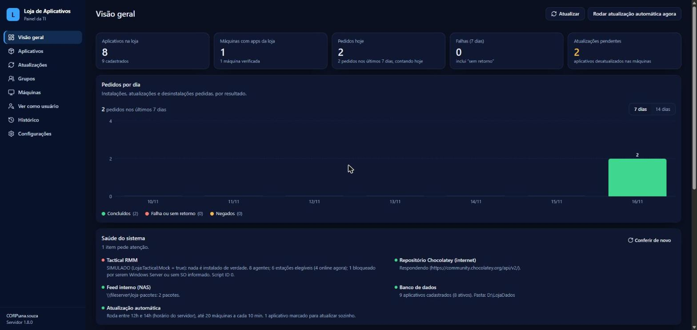
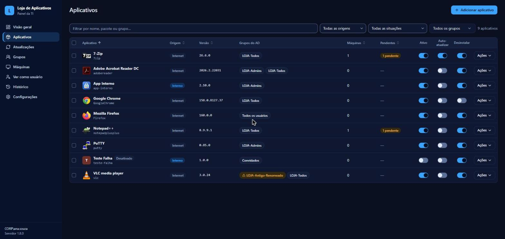
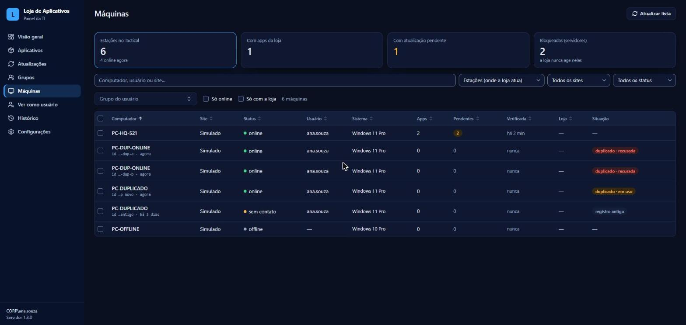
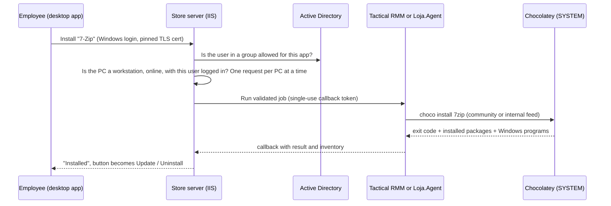

# Self-Service App Store for Windows Domains

[](https://github.com/bisquilha/self-service-app-store/actions/workflows/build.yml)

An internal, free **app store for company PCs**. Employees install approved software by themselves, **without local admin rights and without opening a ticket**, while IT decides who can install what through Active Directory groups and keeps a full audit trail.

Built from scratch and running in production at a multi-site company (hundreds of workstations, no local admin for users). This is a generic, sanitised version: no company names, hosts, IPs or credentials. UI texts are in Portuguese.

---

## Screenshots

Admin panel with demo data (simulated RMM, fictitious users and machines):







## Pieces

| Folder | What it is | Stack |
|---|---|---|
| `src/Loja.Server` | API + web admin host. Windows authentication (Kerberos/Negotiate), catalog per AD group, request queue, history, auto-update, health checks | ASP.NET Core 8 on IIS, SQLite |
| `src/Loja.Admin` | Admin panel (`/admin`): apps, AD groups, machines, updates, history, "view as user", settings | React 19, TypeScript, Vite, Tailwind v4, shadcn/ui |
| `src/Loja.App` | Desktop app employees open from a shortcut (deployed by GPO), light/dark theme, self-update | WPF (.NET 8) |
| `src/Loja.Agent` | Optional Windows service (SYSTEM) that executes installs, so the store does not need an RMM | .NET 8 worker service |
| `src/Loja.Shared` | API contract shared by server, app and agent | .NET 8 |
| `tactical/Loja-Choco.ps1` | The single script the store asks Tactical RMM to run (validated parameters only) | PowerShell 5.1, Chocolatey |
| `deploy/` | Build/publish, IIS install, AD groups, GPO deployment, internal package builder | PowerShell |
| `tests/` | 17 API test suites, each against a fresh demo server with a simulated RMM | PowerShell, Python |

## How an install works



## Design decisions worth reading

- **Users never get admin rights.** Installs run as SYSTEM through the RMM agent or the store's own agent; the user only clicks.
- **Least privilege for the RMM key.** Tactical roles cannot restrict *which* scripts an API key runs, so the key lives only on the server and the allow-list of actions (install / upgrade / uninstall / list) and package IDs is enforced there. It never ships inside the desktop app.
- **Machine identity without secrets.** The optional agent authenticates with the computer's own Kerberos account (`PC$`), and the server checks that a PC can only act for itself.
- **Servers are refused twice**, by OS type, even if the RMM lists them as workstations.
- **AD groups stored by SID**, so renaming a group does not silently revoke access; unknown groups are rejected when saved.
- **Internal packages** (company software) come from a file-share Chocolatey feed. Their IDs must differ from public ones, because Chocolatey picks the highest version across sources (learned the hard way).
- **TLS pinning** in the app and scripts, with the trap documented: endpoint-protection HTTPS inspection re-signs the certificate and breaks the pin, so the store host needs an exclusion.
- **Self-update without fighting a running exe:** new versions are staged per user and applied on the next launch; mandatory releases can force a restart; any version can be rolled back from the panel.
- **CSRF protection** on every admin write (`X-Requested-With`), CSV export guarded against formula injection, accessible UI (keyboard, screen-reader names, WCAG contrast checked by script).

## Running locally

The development profile uses a **simulated Tactical RMM** (nothing is really installed) and makes everyone an admin.

```powershell
dotnet run --project src\Loja.Server        # http://localhost:5080
dotnet run --project src\Loja.App           # desktop app pointing to localhost
cd src\Loja.Admin; npm ci; npm run build    # admin panel -> src\Loja.Server\wwwroot\admin
```

Requirements: .NET 8 SDK, Node 20.19+ (only to build the panel), Windows (WPF, Windows authentication).

## Tests

```powershell
.\tests\run-suites.ps1 -Feed C:\temp\loja-pacotes
```

Each suite gets a new demo server and a new data folder, then prints OK / FALHA / PULOU. Some suites read Active Directory (run from a domain-joined PC), search the public Chocolatey feed (internet) and need a folder with two test `.nupkg` packages. See `tests/README.md`.

## Tech

C# / .NET 8 · ASP.NET Core · WPF · SQLite · React 19 · TypeScript · Vite · Tailwind CSS v4 · shadcn/ui · PowerShell · Chocolatey · Tactical RMM API · Active Directory (Kerberos, SIDs, tokenGroups) · IIS · GPO

---

## Resumo em português

Loja interna e gratuita de aplicativos para PCs da empresa. O funcionário instala sozinho, **sem senha de administrador e sem abrir chamado**, os programas que os grupos do AD dele permitem. A TI controla tudo por um painel web (React) e tem histórico e auditoria completos.

- **Componentes:** servidor ASP.NET Core 8 no IIS, app de desktop em WPF com atualização automática e agente opcional em serviço do Windows.
- **Instalação:** feita como SYSTEM via Tactical RMM ou pelo agente próprio, usando o Chocolatey (internet ou repositório interno).

Usado em produção; esta é uma versão genérica, sem dados da empresa.

## License

[MIT](LICENSE)
